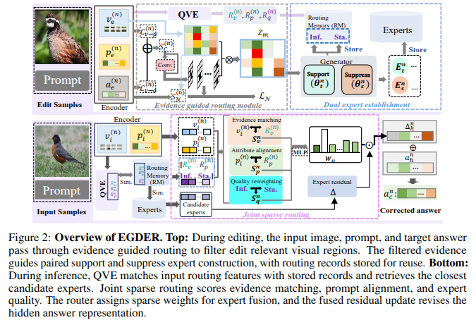

# EGDER

Code for **Evidence Guided Dual Expert Memory with Joint Routing for VLLMs Online Correction**.



EGDER combines evidence-guided visual localization, paired support/suppress experts,
quality estimation, and joint sparse routing for online multimodal knowledge editing.

## Implementation

- [egder/egder.py](egder/egder.py): the `EGDER` editor, expert memory, editing, and training.
- [egder/modules.py](egder/modules.py): visual localization, dual expert generation, quality heads, and joint routing.
- [configs/egder/blip2-opt-2.7b.yaml](configs/egder/blip2-opt-2.7b.yaml): the BLIP2 OPT-2.7B configuration.

## Setup

Use Python 3.10 and a CUDA-compatible PyTorch installation.

```bash
pip install -r requirements.txt
git clone https://github.com/qizhou000/LiveEdit.git ../LiveEdit-runtime
git -C ../LiveEdit-runtime checkout 3615a37b05294509f411df045621940f276a5e6b
```

Provide the BLIP2 OPT-2.7B backbone, MMEdit EVQA data, and the compatible editor
checkpoint separately. The data root must contain `vqa/vqa_eval.json` and
`images/`. The pinned checkout supplies the shared backbone and evaluation runtime.
Model weights and datasets are not included.

## Code verification

Run the numerical checks for mask gradients, quality supervision, and joint routing:

```bash
CUDA_VISIBLE_DEVICES=2 python -m unittest discover -s tests -v
python evaluate.py --help
python install_egder.py --help
```

## Performance verification

Run EGDER in a fresh process. Physical GPU selection uses `CUDA_VISIBLE_DEVICES`;
the runner uses logical `cuda:0`.

```bash
CUDA_VISIBLE_DEVICES=2 CUBLAS_WORKSPACE_CONFIG=:4096:8 python evaluate.py \
  --upstream ../LiveEdit-runtime --method egder \
  --checkpoint /path/to/egder/checkpoint.pt \
  --backbone /path/to/blip2-opt-2.7b --data-root /path/to/easy-edit-mm \
  --output /path/to/new-output/egder
```

For the LiveEdit comparison, the runner loads the official implementation directly
from the pinned checkout with its own compatible checkpoint:

```bash
CUDA_VISIBLE_DEVICES=2 CUBLAS_WORKSPACE_CONFIG=:4096:8 python evaluate.py \
  --upstream ../LiveEdit-runtime --method liveedit \
  --checkpoint /path/to/liveedit/checkpoint.pt \
  --backbone /path/to/blip2-opt-2.7b --data-root /path/to/easy-edit-mm \
  --output /path/to/new-output/liveedit
```

The runner loads every editor module strictly and invokes the pinned official
`test_vllm_edit.py` with `-sen 1000` and no `-dsn`. The official scoring functions
remain unchanged.

To register EGDER for the upstream training entrypoint, use a separate checkout:

```bash
git clone https://github.com/qizhou000/LiveEdit.git ../EGDER-runtime
git -C ../EGDER-runtime checkout 3615a37b05294509f411df045621940f276a5e6b
python install_egder.py ../EGDER-runtime
```

Then select `-en egder` in `train_vllm_editor.py`. Keep the official baseline checkout separate.

## Citation

Please cite the
[LiveEdit paper (CVPR 2025)](https://openaccess.thecvf.com/content/CVPR2025/html/Chen_Lifelong_Knowledge_Editing_for_Vision_Language_Models_with_Low-Rank_Mixture-of-Experts_CVPR_2025_paper.html)
when using the shared framework:

```bibtex
@InProceedings{Chen_2025_CVPR,
  author = {Chen, Qizhou and Wang, Chengyu and Wang, Dakan and Zhang, Taolin and Li, Wangyue and He, Xiaofeng},
  title = {Lifelong Knowledge Editing for Vision Language Models with Low-Rank Mixture-of-Experts},
  booktitle = {Proceedings of the IEEE/CVF Conference on Computer Vision and Pattern Recognition (CVPR)},
  year = {2025},
  pages = {9455--9466}
}
```

The upstream copyright and permission notice are preserved in `LICENSE.upstream`.
